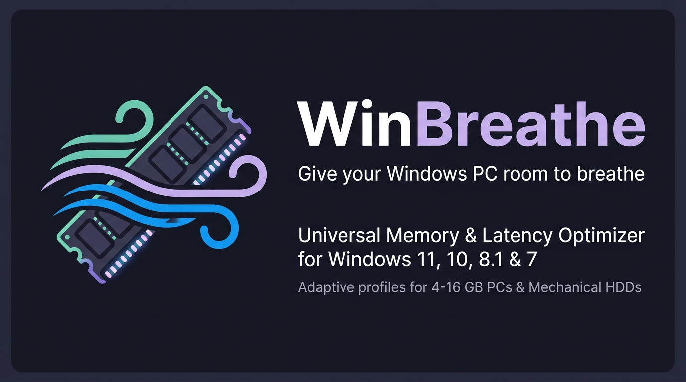
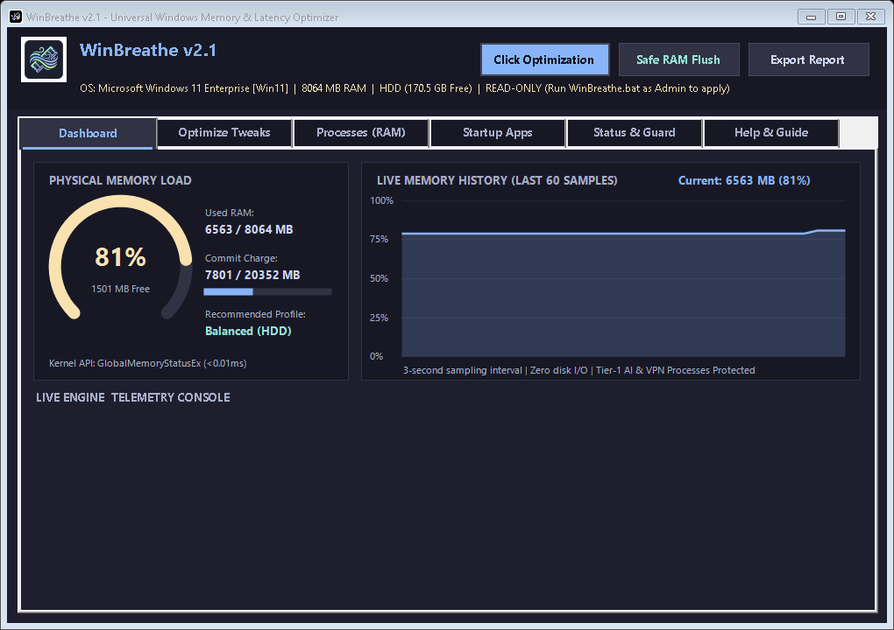
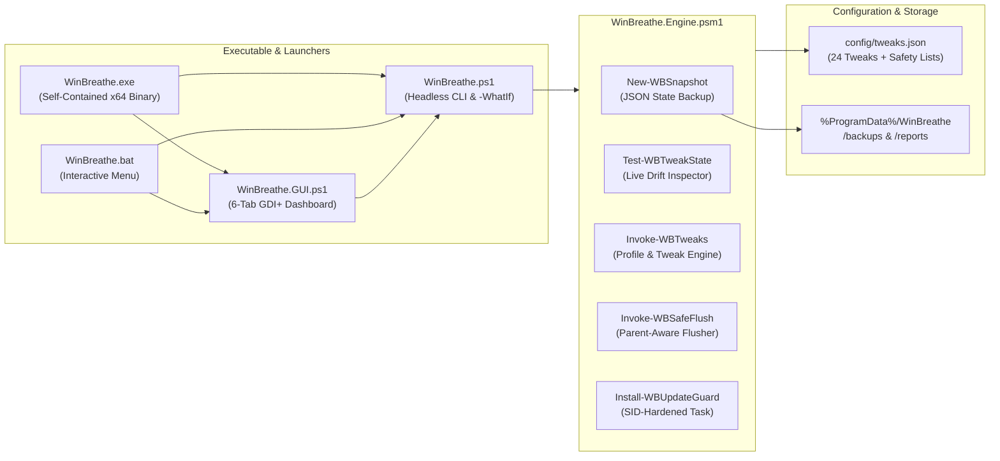

<div align="center">



# WinBreathe

**Hardware-Adaptive Windows 11 Memory & Latency Optimizer for 4–16 GB RAM PCs, Mechanical HDDs & AI Developer Stacks**

[](https://microsoft.com)
[](releases/)
[](WinBreathe.exe)
[](LICENSE)
[](SECURITY.md)

[Downloads (v1 & v2)](#-releases--downloads-v110--v200) • [Features](#-whats-new-in-v20) • [Quick Start](#-quick-start) • [Architecture](#-architecture--how-it-works) • [Tweak Catalog](docs/TWEAKS.md) • [Structure Comparison](docs/GITHUB_STRUCTURE_COMPARISON.md) • [FAQ](docs/FAQ.md)

</div>

---

<div align="center">
  
  <p><em>Native 6-Tab WinForms Dark Dashboard running live with Circular RAM Gauge and 60-point Memory History Chart (< 18 MB footprint).</em></p>
</div>

## Why WinBreathe Exists

Millions of **students, researchers, and developers rely on older laptops and budget PCs** (typically equipped with **4 to 12 GB of RAM** and mechanical 5,400 RPM hard drives). Over time, as Windows 11 receives cumulative updates, background system bloat accumulates steadily:

- **The Student & Everyday User Dilemma**: Simply opening a browser for study, research, or video lectures causes modern Chromium browsers (Microsoft Edge, Google Chrome) to spawn **30 to 40 hidden background renderer and utility processes**, quietly consuming **1.5 GB to 2.5 GB of RAM** before any actual work begins.
- **Background Service & Widget Drag**: Background telemetry (`DiagTrack`), Windows Widgets, cross-device helpers, and Cortana/Bing web search constantly churn memory pages and mechanical disk I/O in the background, starving student coursework and essential apps.
- **The "RAM Cleaner" Trap (`EmptyWorkingSet`)**: Conventional "memory boosters" aggressively call `EmptyWorkingSet()`, forcibly flushing active memory pages out of RAM and onto the slow spinning hard drive. The second a student switches between Word, PDF readers, and browser tabs, the computer experiences severe **hard page fault cascades**—freezing the entire system for 5 to 15 seconds.
- **Pagefile Fragmentation Stutters**: Under heavy RAM load, Windows' default auto-growing pagefile constantly resizes and fragments across mechanical disks, causing 100% disk active time and unbearable system stutter.
- **AI Coding Stack Multiplication**: For computer science and engineering students running AI assistants (**ChatGPT**, **Antigravity**, **VS Code**, **Cursor**, **Python**, **Node.js**), developer runtimes add another **2.5 GB to 3.5 GB of memory pressure**, pushing an 8 GB laptop beyond its physical threshold.

**WinBreathe** gives these constrained systems **room to breathe** as a lightweight, standalone Windows executable (`WinBreathe.exe`), reclaiming up to **1.5 GB+ of physical RAM** without kernel drivers, background bloatware, or destructive memory dumping.

---

## Releases & Downloads (`v1.1.0` & `v2.0.0`)

Both **Version 1 (`v1.1.0`)** and **Version 2 (`v2.0.0`)** are pre-compiled and included in the [`releases/`](releases/) directory with SHA-256 checksum manifests:

| Version | Standalone x64 Executable (`.exe`) | Portable Archive (`.zip`) | Checksums | Highlights |
| :--- | :--- | :--- | :--- | :--- |
| **v2.0.0** *(Latest)* | [`WinBreathe-v2.0.0-x64.exe`](releases/v2.0.0/WinBreathe-v2.0.0-x64.exe) *(+ root [`WinBreathe.exe`](WinBreathe.exe))* | [`WinBreathe-v2.0.0-Portable.zip`](releases/v2.0.0/WinBreathe-v2.0.0-Portable.zip) | [`SHA256SUMS.txt`](releases/v2.0.0/SHA256SUMS.txt) | 6-Tab GDI+ Dark Dashboard, Circular RAM Gauge & Live History Chart, 24-Tweak JSON Catalog, True Snapshot Undo, `-WhatIf` Preview, Startup Manager, Drift Detector, HTML/MD Reports |
| **v1.1.0** *(Legacy)* | [`WinBreathe-v1.1.0-x64.exe`](releases/v1.1.0/WinBreathe-v1.1.0-x64.exe) | [`WinBreathe-v1.1.0-Portable.zip`](releases/v1.1.0/WinBreathe-v1.1.0-Portable.zip) | [`SHA256SUMS.txt`](releases/v1.1.0/SHA256SUMS.txt) | Classic Single-Window Dark GUI, 1-Click Tier 1/2/3 Optimizer, Update Guard & Windows Defaults Restore |

---

## What's New in v2.0

| Feature | Description |
| :--- | :--- |
| **Native Self-Contained `.EXE`** | Compiled via `csc.exe` ([`Compile.ps1`](Compile.ps1)) with embedded resources, custom icon, `PerMonitorV2` DPI awareness, and UAC `requireAdministrator` manifest. Double-click [`WinBreathe.exe`](WinBreathe.exe) to launch immediately. |
| **True Snapshot & 1-Click Undo** | Before changing anything, WinBreathe snapshots your exact registry keys, service startup types, `MMAgent` flags, and pagefile settings to `backup-<timestamp>.json`. Clicking **Undo** restores your exact prior state—not generic defaults. |
| **Preview / Dry-Run Mode (`-WhatIf`)** | Inspect every single registry value, service change, and memory setting before applying it via the GUI **Preview Selected** button or `WinBreathe.exe -WhatIf`. |
| **Hardware-Adaptive Profiles** | Automatically recommends **Conservative** (16 GB+ SSD), **Balanced** (8–12 GB RAM / HDD), or **Aggressive** (4–6 GB RAM) based on live hardware telemetry. |
| **24-Tweak Interactive Catalog** | Driven by [`config/tweaks.json`](config/tweaks.json) with transparent **Safe**, **Moderate**, and **Advanced** risk badges and per-tweak checkboxes. |
| **6-Tab Native Dark GUI** | Built with GDI+ custom graphics (Circular RAM Gauge + Live 60-Sample Memory History Chart) in the **Catppuccin Mocha** palette (`<18 MB` footprint, zero Electron/WebView overhead). |
| **Top Memory Consumers & Startup Manager** | View processes grouped by application, flush orphaned Search/Widget WebView2 hosts while protecting AI/VPN stacks, and non-destructively toggle Windows Startup apps. |
| **Live Drift Detection & Update Guard** | Green/yellow drift status table shows which tweaks are active vs. reverted by Windows Update, backed by a SID-hardened `SYSTEM` scheduled task (`WinBreathe_UpdateGuard`). |
| **HTML & Markdown Telemetry Reports** | Export shareable before/after optimization and drift reports with one click. |

---

## Architecture & How It Works



---

## Hardware-Adaptive Profiles

| Profile | Recommended Hardware | Included Optimizations |
| :--- | :--- | :--- |
| **Conservative** | **16 GB+ RAM & SSD** | Zero-visible-change tweaks only: disables Edge Startup Boost & browser background persistence, enables Sleeping Tabs (15 min) & Efficiency Mode, and verifies Windows Memory Compression. |
| **Balanced** *(Default)* | **8–12 GB RAM or HDD** | Everything in Conservative + Sleeping Tabs (5 min), disables Edge Sidebar/Copilot/Shopping/Preloading, disables Windows Widgets & Bing Start web search, disables `DiagTrack` telemetry, enables Page Combining, disables App Pre-Launch on HDDs, and sets a fixed contiguous pagefile (`1.5x RAM`, capped `4–12 GB`). |
| **Aggressive** | **4–6 GB RAM / Heavy HDD** | Everything in Balanced + Sleeping Tabs (30 sec), blocks UWP Store apps from running in the background, disables taskbar transparency, and disables `CDPSvc` / `dmwappushservice`. |

> [!NOTE]
> **Windows Search (`svc.wsearch`) is strictly opt-in.** Disabling `WSearch` eliminates background disk indexing on mechanical drives, but also degrades Start Menu and Outlook search. It is **unchecked by default** in every profile and can be enabled manually in the **Optimize Tweaks** tab if you use an alternative tool such as [Everything](https://www.voidtools.com/).

---

## Measured Real-World Impact

*Test system: Lenovo ThinkPad T460, Windows 11 Enterprise (Build 26200), 8,064 MB DDR3L RAM, 1 TB 5,400 RPM HDD, running Antigravity IDE + ChatGPT + OpenVPN Connect + Microsoft Edge.*

| Metric | Before WinBreathe | After WinBreathe (`Balanced`) | Delta |
| :--- | :--- | :--- | :--- |
| **Physical RAM Used** | `6,881 MB` (85% Load) | `5,301 MB` (65% Load) | **`-1,580 MB` Used** |
| **Available Physical RAM** | `1,183 MB` | `2,763 MB` | **`+1,580 MB` (+133% Free Headroom)** |
| **Browser + WebView2 Footprint** *(3 open tabs)* | `~1,813 MB` (~40 processes) | `~550 MB` (Sleeping Tabs + No Sidebar/Widgets) | **`~1,260 MB` Reclaimed** |
| **Pagefile Allocation** | Dynamic Auto-Grow (Fragmented) | `12,288 MB` Fixed Contiguous | **Zero Resize Thrashing** |

---

## 🪟 Windows OS Compatibility & Roadmap

WinBreathe is designed to dynamically adapt to the underlying Windows version and hardware:

| Operating System | Compatibility Status | Coverage & Behavior |
| :--- | :---: | :--- |
| **Windows 11** (21H2, 22H2, 23H2, 24H2+) | **Full Support (Current)** | Complete feature set active: Widgets, Bing search removal, Edge policies, Kernel Memory Compression, and contiguous fixed pagefile. |
| **Windows 10** (1809, 20H2, 21H2, 22H2) | **Full Support (Current)** | Complete feature set active: Chromium/Edge background throttling, Sleeping Tabs, `DiagTrack` telemetry, Memory Compression, fixed HDD pagefile, and Startup Manager. |
| **Windows Server** (2016, 2019, 2022, 2025) | **Full Support (Current)** | Full server support: Policy locks, memory compression, process protection, and pagefile controls active. Consumer features safely bypassed. |
| **Windows 7 SP1 & Windows 8.1** | **Roadmap (v2.1.0 Release)** | **Targeted for the upcoming v2.1.0 milestone**: Adding legacy kernel memory management fallback, classic Superfetch/Prefetch tuning, classic IE/legacy Chromium flags, and .NET Framework 4.5 fallback paths to support legacy student PCs. |

---

## Quick Start

### Option 1: Standalone Executable (Recommended)
Double-click **`WinBreathe.exe`** (or download [`WinBreathe-v2.0.0-x64.exe`](releases/v2.0.0/WinBreathe-v2.0.0-x64.exe)) and approve the Windows UAC prompt to open the 6-tab graphical dashboard.

### Option 2: CLI Arguments via `WinBreathe.exe` or `WinBreathe.ps1`
```powershell
# Launch the 6-tab Dark GUI
.\WinBreathe.exe

# Preview all Balanced profile changes without touching the system
.\WinBreathe.exe -Profile Balanced -WhatIf

# Apply the Balanced profile (automatically creates a JSON state snapshot first)
.\WinBreathe.exe -Profile Balanced

# Check live tweak drift & hardware telemetry
.\WinBreathe.exe -Status

# Undo optimization and restore your exact pre-optimization snapshot
.\WinBreathe.exe -Undo

# Rebuild v1.1.0 and v2.0.0 executables from source
.\Compile.ps1
```

---

## Repository Structure (Modeled After Top-Starred GitHub Utilities)

This repository follows the structural conventions of the highest-starred Windows optimization repositories on GitHub ([`ChrisTitusTech/winutil`](https://github.com/ChrisTitusTech/winutil) and [`hellzerg/optimizer`](https://github.com/hellzerg/optimizer)). See [`docs/GITHUB_STRUCTURE_COMPARISON.md`](docs/GITHUB_STRUCTURE_COMPARISON.md) for the full comparison.

```text
WinBreathe/
├── WinBreathe.exe                  # Compiled self-contained x64 executable (v2.0.0)
├── WinBreathe.bat                  # Self-elevating interactive CLI/GUI menu launcher
├── Compile.ps1                     # Build pipeline: compiles v1.1.0 & v2.0.0 .exe + .zip + SHA256
├── config/
│   └── tweaks.json                 # Declarative 24-tweak catalog & protected process list
├── src/
│   ├── WinBreathe.Engine.psm1      # Core optimization, telemetry, snapshot & guard module
│   ├── WinBreathe.ps1              # CLI entrypoint (-Profile, -WhatIf, -Status, -Undo...)
│   ├── WinBreathe.GUI.ps1          # 6-tab WinForms dark GUI with custom GDI+ charts
│   ├── Launcher/                   # Native C# executable host (Program.cs + app.manifest)
│   └── v1/                         # Legacy v1.1.0 source files
├── releases/
│   ├── v1.1.0/                     # WinBreathe-v1.1.0-x64.exe, Portable.zip & SHA256SUMS.txt
│   └── v2.0.0/                     # WinBreathe-v2.0.0-x64.exe, Portable.zip & SHA256SUMS.txt
├── assets/
│   ├── banner.png                  # Repository social banner
│   ├── feature-art.png             # Dashboard visual overview art
│   ├── logo.png                    # Application brand mark
│   └── icon.ico                    # Application window & executable icon
├── docs/
│   ├── TWEAKS.md                   # Complete reference for all 24 tweaks & undo paths
│   ├── ARCHITECTURE.md             # Internal design, security model & Win32 APIs
│   ├── GITHUB_STRUCTURE_COMPARISON.md # Structural alignment with winutil & optimizer
│   └── FAQ.md                      # Frequently asked questions & troubleshooting
├── .github/
│   ├── workflows/                  # lint.yml & build-release.yml (Automated CI/CD)
│   ├── ISSUE_TEMPLATE/             # bug_report.yml & feature_request.yml
│   └── PULL_REQUEST_TEMPLATE.md
├── CHANGELOG.md
├── CODE_OF_CONDUCT.md
├── CONTRIBUTING.md
├── SECURITY.md
└── LICENSE
```

## License

Released under the [MIT License](LICENSE).
