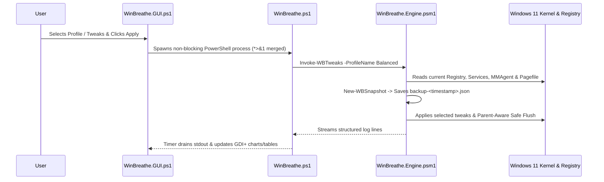

> Historical documentation: defaults and compatibility claims below may predate v2.1.0. Use [current release notes](RELEASE-2.1.0.md) and the current catalog for supported behavior. Legacy performance remains unverified.

# WinBreathe v2.0 — Architecture & Security Design

## 1. Execution & Data Flow

---

## 2. Core Subsystems

### 2.1 Zero-Overhead Memory Telemetry (`GlobalMemoryStatusEx`)
Instead of querying slow WMI `Win32_OperatingSystem` instances on every UI refresh (which causes WMI provider CPU spikes), `WinBreathe.Engine.psm1` P/Invokes `kernel32.dll!GlobalMemoryStatusEx` directly via an inline C# `MEMORYSTATUSEX` struct. Each sample takes `< 0.01 ms` with zero disk or WMI overhead.

### 2.2 Faithful Snapshot & Undo (`New-WBSnapshot` / `Restore-WBSnapshot`)
Prior to applying any optimization:
1. Every registry entry in `config/tweaks.json` is queried. Both `Exists` (`true`/`false`) and the prior `Value` are recorded.
2. Every targeted Windows Service (`DiagTrack`, `MapsBroker`, `WSearch`, etc.) and matched optional service has its exact `StartType` and running `Status` recorded.
3. Current `MMAgent` properties and `PagingFiles` (`REG_MULTI_SZ`) values are recorded.
4. The snapshot is written to `%ProgramData%\WinBreathe\backups\backup-<timestamp>.json` and mirrored to `latest.json`.

When `Restore-WBSnapshot` (`-Undo`) runs, keys that did not exist prior to WinBreathe are deleted cleanly (`Remove-ItemProperty`), and keys/services that existed are restored to their exact user state.

### 2.3 Parent-Aware WebView2 Flushing (`WB-03` Protection)
Modern AI coding IDEs (VS Code, Antigravity, Cursor, Claude Desktop) embed `msedgewebview2.exe` processes. A naive `Stop-Process -Name msedgewebview2` crashes active developer tools.
`Invoke-WBSafeFlush` inspects `Win32_Process.ParentProcessId` and `CommandLine`, ensuring:
- Any `msedgewebview2.exe` whose parent is in `protectedProcesses` is **never touched**.
- Only transient WebView2 hosts spawned by `SearchHost`, `Widgets`, `WidgetService`, or orphaned parents are flushed.

### 2.4 Context-Aware `HKCU` Resolution Under `SYSTEM` (`WB-07`)
When the Update Guard scheduled task runs at boot under `NT AUTHORITY\SYSTEM` (`S-1-5-18`), PowerShell's `HKCU:\` drive points to `HKEY_USERS\.DEFAULT` instead of the interactive user's registry hive. `Resolve-WBRegistryPath` detects `S-1-5-18`, resolves the logged-on user's SID via `Win32_ComputerSystem`, and transparently redirects `HKCU:\` writes to `HKU:\<User-SID>\`.

### 2.5 Locale-Independent ACL Hardening (`WB-02`)
Because `WinBreathe_UpdateGuard` executes as `SYSTEM`, the `%ProgramData%\WinBreathe` directory is locked down using `[System.Security.Principal.WellKnownSidType]` (`BuiltinAdministratorsSid`, `LocalSystemSid`, `BuiltinUsersSid`) rather than localized account names (`BUILTIN\Administrators`), preventing Local Privilege Escalation (LPE) across all Windows languages.
